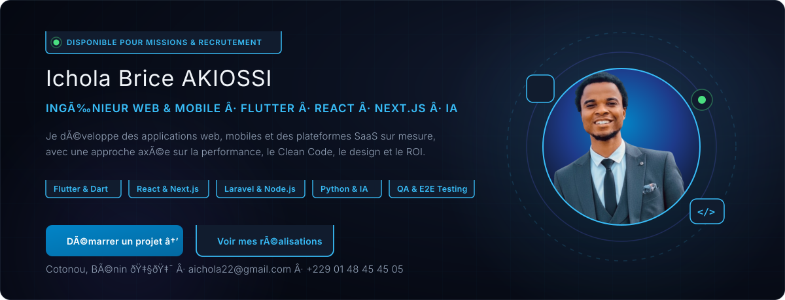
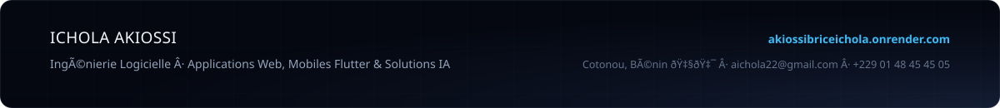

<!-- HERO BANNER OFFICIEL (Dark Mode du Portfolio avec polices Frijole & Barlow, boutons sans border-top & avatar) -->

  

<!-- NAVIGATION DIRECTE ÉPURÉE -->
[**Portfolio**](https://akiossibriceichola.onrender.com/) &nbsp;•&nbsp;
[**LinkedIn**](https://www.linkedin.com/in/ichola-brice-akiossi-0420122b0) &nbsp;•&nbsp;
[**WhatsApp**](https://wa.me/22948454505) &nbsp;•&nbsp;
[**Email**](mailto:aichola22@gmail.com) &nbsp;•&nbsp;
[**Facebook**](https://web.facebook.com/IcholaAKIOSSI) &nbsp;•&nbsp;
[**GitHub**](https://github.com/Ichola90)

  

---

## À propos de moi

Je suis **Ichola Brice AKIOSSI**, ingénieur logiciel basé à Cotonou, Bénin 🇧🇯, disponible pour des opportunités en présentiel ainsi qu'en remote international.

J'accompagne les entreprises, startups et porteurs de projets dans la création de solutions numériques sur mesure :
- **Applications mobiles cross-platform** sous Flutter & Dart (iOS & Android).
- **Applications web & plateformes SaaS scalables** avec React, Next.js, Laravel et TypeScript.
- **Intégration d'intelligence artificielle & automatisation** de workflows métiers (Python, agents IA).
- **Assurance qualité & tests automatisés** pour garantir des applications robustes et sans régression.
- **Optimisation SEO technique & Web Performance** (Core Web Vitals, structure sémantique et accessibilité).
- **Direction artistique & design d'interfaces** (Figma, identité visuelle et branding de marque).

Mon approche est résolument orientée résultats : comprendre vos enjeux métiers, concevoir une architecture logicielle pérenne et délivrer une expérience utilisateur soignée à fort retour sur investissement.

---

## Stack technique

### Développement Mobile
- **Flutter & Dart** — Applications mobiles cross-platform iOS & Android fluides, performantes et connectées à des APIs modernes.
- **Architectures mobiles** — Gestion d'état avancée (Riverpod, Bloc, Provider), respect des guidelines Material Design & Cupertino.

### Frontend Web
- **React.js & Next.js** — Applications web modernes, Server-Side Rendering (SSR), Static Site Generation (SSG) et plateformes interactives.
- **Vue.js 3 & Nuxt** — Interfaces réactives, modulaires et performantes.
- **TypeScript & JavaScript (ES6+)** — Typage statique rigoureux, robustesse et maintenabilité du code source.
- **Tailwind CSS & Bootstrap** — Conception d'interfaces élégantes, ergonomiques et adaptées à tous les écrans.

### Backend & APIs
- **Laravel & PHP** — Architectures SaaS scalables, logique métier avancée, ORM Eloquent et sécurité applicative.
- **Node.js & Express.js** — Microservices rapides, APIs asynchrones et gestion temps réel.
- **Symfony** — Composants d'entreprise modulaires et structurés.
- **APIs REST & GraphQL** — Conception, documentation et sécurisation d'APIs performantes.

### Bases de données & Infrastructure
- **PostgreSQL & MySQL** — Modélisation relationnelle, requêtes optimisées, intégrité et indexation haute performance.
- **Docker & Conteneurs** — Environnements isolés, standardisation et déploiements reproductibles.
- **GitHub Actions & CI/CD** — Automatisation des tests et pipelines de livraison continue.
- **Git & Systèmes Linux** — Gestion de versions, workflows collaboratifs et administration système.

### Intelligence Artificielle & Automatisation
- **Python & Scripts autonomes** — Automatisation de tâches répétitives, scraping éthique et traitement de données.
- **Agents IA & Intégration LLM** — Connexion de modèles génératifs intelligents aux processus métiers d'entreprises.

### Assurance Qualité & Testing
- **Playwright, Cypress & Selenium WebDriver** — Suites complètes de tests automatisés End-to-End (E2E) et de non-régression.
- **Postman & API Testing** — Validation fonctionnelle, tests d'intégration et contrôle de conformité des APIs.

### Design Graphique & UI/UX
- **Figma** — Prototypage UI/UX, wireframes interactifs et design systems.
- **Adobe Photoshop & Adobe Illustrator** — Création de logotypes vectoriels, chartes graphiques et supports de marque.

---

## Projets & Réalisations phares

| Projet | Description | Stack technique | Lien direct |
|:-------|:------------|:----------------|:-----------:|
| **DOCS SHOW** | Bibliothèque numérique interactive de livres tech avec lecture chapitre par chapitre, progression et quiz de validation. | Next.js · React · TypeScript · Tailwind CSS | [Visiter le site ↗](https://docsshow.vercel.app/) |
| **Votify** | Plateforme sécurisée de vote en temps réel et collecte de contributions financières (dons) pour événements et cérémonies. | Full Stack · Laravel · React · Paiement | [Découvrir ↗](https://votify.asoras.net/) |
| **eChillo** | Solution numérique de billetterie en ligne et commercialisation de tickets avec génération de QR codes sécurisés. | Laravel · React · QR Code Verification · API | [Voir le projet ↗](https://echilloriri.onrender.com/) |
| **TAHFUS** | Plateforme éducative d'e-learning et de commercialisation de formations en ligne à destination d'un public international. | Web Platform · E-learning · Auth & Billing | [Explorer ↗](http://tahfustest.onrender.com/) |
| **Premium Agency Template** | Modèle de site web moderne, élégant, responsive et optimisé SEO pour agences digitales et organisations. | Next.js · React · Tailwind CSS · SEO | [Aperçu Live ↗](https://agencytest.onrender.com/) |
| **Portfolio Xavier Atchadé** | Vitrine professionnelle sur mesure, responsive et soignée mettant en valeur projets, parcours et expertises. | React · UI/UX Design · Performance Web | [Consulter ↗](https://xavieratchade.onrender.com/) |
| **Digicraft Market** | Identité visuelle complète, direction artistique et logotype vectoriel pour une boutique en ligne de produits digitaux. | Branding · Figma · Adobe Illustrator | [Détails ↗](https://digicraft-market.mychariow.shop/) |
| **Ayomide Plumbing Enterprise** | Direction artistique et logotype officiel pour une entreprise spécialisée en plomberie et installations sanitaires. | Branding · Signalétique · Charte graphique | Sur devis |

---

## Services & Solutions

- **Développement Web & Plateformes SaaS** : Conception de sites vitrines, portails d'entreprise et logiciels SaaS performants, rapides et optimisés pour la conversion.
- **Développement Mobile Flutter & Dart** : Applications cross-platform iOS & Android natives, fluides, avec intégration d'APIs et interfaces modernes.
- **Agents IA & Automatisation** : Déploiement d'assistants intelligents connectés à vos outils métiers et automatisation de processus pour gagner en productivité.
- **Assurance Qualité & QA Testing** : Mise en place de bancs de tests E2E automatisés (Playwright, Cypress, Selenium) et validation d'APIs.
- **SEO Technique & Core Web Vitals** : Audit et optimisation technique complète (temps de chargement, données structurées Schema.org, balisage sémantique).
- **Design Graphique & Identité de Marque** : Logotypes vectoriels percutants, chartes graphiques de marque et maquettes UI/UX sur Figma.

---

## Disponibilité & Recrutement

Je suis ouvert et disponible pour :
- **Recrutement à temps plein ou temps partiel** (CDI, CDD, missions freelance).
- **Missions en présentiel** (Cotonou / Bénin) ou **100% remote** à l'international.
- **Conception, refonte et audit** de plateformes web, SaaS et applications mobiles.

---

## Me contacter

| Canal | Coordonnées / Accès direct |
|:------|:---------------------------|
| **Portfolio officiel** | [akiossibriceichola.onrender.com](https://akiossibriceichola.onrender.com/) |
| **WhatsApp direct** | [+229 01 48 45 45 05](https://wa.me/22948454505) |
| **Email direct** | [aichola22@gmail.com](mailto:aichola22@gmail.com) |
| **LinkedIn** | [linkedin.com/in/ichola-brice-akiossi](https://www.linkedin.com/in/ichola-brice-akiossi-0420122b0) |
| **Facebook** | [facebook.com/IcholaAKIOSSI](https://web.facebook.com/IcholaAKIOSSI) |
| **GitHub** | [github.com/Ichola90](https://github.com/Ichola90) |

 

<!-- FOOTER OFFICIEL (Dark Mode du Portfolio avec police Frijole) -->

